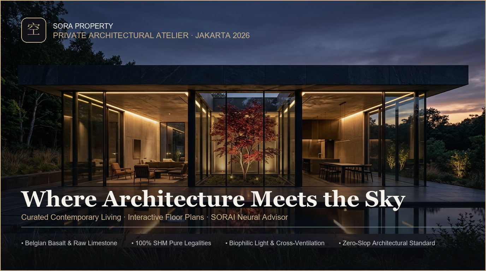

<p align="center">
  
</p>

# SORA PROPERTY
### Contemporary Architectural Living, Spatial Curation & Interactive 3D Intelligence

> **SORA (空)** — Derived from the Japanese architectural concept of open sky and meaningful void (*Ma*). A boutique curation of contemporary residences where volumetric massing, natural daylighting, and landscape harmoniously converge in quiet grandeur.

---

## Overview

**SORA Property** is a digital architectural atelier and boutique property portfolio engineered to bridge discerning design connoisseurs with architecturally uncompromising residences. It integrates high-contrast editorial aesthetics, interactive 2D blueprint layouts, a real-time procedural **3D Volumetric Massing & Solar Path Simulator**, a transparent financial annuity engine, and **SORAI (SORA Architectural Intelligence)**.

Guided by the principles of **Material Honesty** and **Anti-Generic Design**, SORA eliminates artificial decoration, cheap gradients, and sensory clutter in favor of raw materials, bold cantilevers, and authentic structural expression.

---

## Architectural Principles & Design System

* **Material Color Palette:**
  * **Belgian Basalt (`#0A0B0E`)** — Deep, obsidian foundation evoking textured black slate and quiet shadow.
  * **Raw Limestone (`#F5F2EB`)** — Natural travertine and limestone white with superior contrast and editorial clarity.
  * **Aged Brass (`#CBB38B`)** — Muted, brushed architectural brass accents providing warmth without excessive sheen.
* **Typographic Hierarchy:**
  * **Headings:** *Cinzel* — Monumental modern classical serif commanding respect and architectural permanence.
  * **Body Copy:** *Plus Jakarta Sans* — Neutral, ergonomic, and highly legible contemporary grotesque.
  * **Numerals & Metrics:** *Space Grotesk* configured with tabular numerals (`font-feature-settings: 'tnum' on, 'zero' on`) to ensure zero character-width drift across prices, land areas, and coordinates.
* **Kinetic & Spatial Depth:**
  * **Dynamic Cursor Spotlight:** Ambient radial glow tracking pointer coordinates across cards and glass panels.
  * **CSS 3D Dynamic Perspective Tilt:** Subtle 3D card elevation and tilt (`perspective: 1000px`, ±5.5°) with specular light reflection on desktop viewports.
  * **Architectural Blueprint Scanner:** Laser sweep animation across CAD floor plans for technical precision feedback.
  * **SORAI Response Empathy:** Realistic typing bounce indicators simulating neural architectural deliberations.

---

## Curated Masterpiece Portfolio

Each residence in the SORA collection represents a distinct architectural typology, calibrated to preserve natural daylighting, cross-ventilation, and structural integrity.

| Unit | Typology & Location | Price & Est. Mortgage | Key Specifications | Lead Architect |
| :--- | :--- | :--- | :--- | :--- |
| **The Skylight Pavilion** | Tropical Brutalist<br>BSD City, South Tangerang | **Rp 8,800,000,000**<br>(Est. Rp 48,240,000 / mo) | **420 m²** Land / Built-up<br>4 BR + 1 Studio • Atrium Void | Studio Andramatin Partner |
| **Mori Zen Sanctuary** | Japandi Warm Minimalist<br>Cipete, South Jakarta | **Rp 6,900,000,000**<br>(Est. Rp 37,800,000 / mo) | **310 m²** Land / Built-up<br>3 BR Ensuite • Engawa Deck | Atelier SORA |
| **Komorebi Courtyard** | Modern Courtyard Living<br>Bintaro Sector 9, South Tangerang | **Rp 5,200,000,000**<br>(Est. Rp 28,500,000 / mo) | **280 m²** Land / Built-up<br>3 BR + Creative Studio • Lightwell | Kalandra Studio |
| **The Aether Glass Villa** | Cantilevered Cliffside Luxury<br>Sentul Highlands, Bogor | **Rp 14,500,000,000**<br>(Est. Rp 79,400,000 / mo) | **580 m²** Land / Built-up<br>5 BR • Infinity Pool • 360° Panorama | Linier Atelier |

### Architectural Highlights

1. **The Skylight Pavilion:**
   * Double-height central atrium (6.5m ceiling) channeling north-south daylighting into the living pavilion.
   * Central inner courtyard featuring a mature specimen tree and reflective water rill.
   * Non-porous fair-faced architectural exposed concrete coupled with 16mm double-glazed Low-E thermal acoustic glass.
2. **Mori Zen Sanctuary:**
   * FSC-certified Indonesian teak woodwork juxtaposed against breathable, moisture-regulating lime plaster walls.
   * Raised floating *engawa* veranda wrapping around a raked *karesansui* dry rock garden.
   * Custom black stone terrazzo soaking onsen tub in the private master sanctuary.
3. **Komorebi Courtyard:**
   * Locally crafted high-precision terracotta brickwork with vertical timber louvers filtering harsh afternoon glare.
   * Vehicle-free inner green court designed as a serene central social sanctuary.
   * Vertical solar chimney stack effect expelling rising heat naturally without reliance on continuous HVAC.
4. **The Aether Glass Villa:**
   * Dramatic 6-meter steel I-beam cantilevered living wing floating over the mountain cliff contour.
   * Imported Roman vein-cut travertine marble slabs maintaining thermal coolness by day and warmth by night.
   * Heated cantilevered infinity pool blending into the Sentul mountain ridge horizon.

---

## Core Feature Modules

### 1. Interactive 3D Architectural Massing & Solar Path Simulator
Powered by a lightweight procedural Three.js WebGL engine embedded directly within the unit inspection modal:
* **360° Free Orbit & Smooth Damping:** Intuitive mouse/touch orbit controls, pan, and zoom without downloading heavy multi-megabyte 3D files.
* **Real-time Solar Path & Shadow Engine:**
  * Continuous sun-time slider from **07:00 (Morning Light)** to **12:00 (Zenith Noon)** to **17:30 (Golden Hour Sunset)**.
  * Real-time calculation of sun trajectory, directional shadow casting, and Kelvin color temperature shifts to verify daylighting performance.
* **3 Architectural Shading Modes:**
  * **Solid Concrete:** Matte charcoal brutalist concrete with brushed brass framing and biophilic foliage.
  * **Wireframe CAD:** Architectural wireframe mesh reminiscent of studio CAD drafts.
  * **X-Ray Transparent:** Semi-translucent glass volume revealing interior spatial distribution and floor heights.
* **GPU Resource Guard:** Automatically cancels animation loops upon modal dismiss, keeping device CPU/GPU usage at 0%.

### 2. Deep Floor Plan Blueprint & Materiality Breakdown
* **Vector Floor Layouts:** Level 1 and Level 2 architectural zoning schematics delineating public, semi-private, and private suites.
* **Environmental Data:** Real-time orientation vectors, cross-ventilation flow indicators, ceiling heights, and daylight penetration scores.
* **Material Honesty Dossier:** Detailed material specifications (thermal break aluminum frames, non-toxic stone sealers, hybrid 10 kWp solar systems).

### 3. SORA Film — 16-Second Remotion Cinema Trailer
* Algorithmic, code-driven video composition built with **Remotion** and HTML5 Canvas.
* Features subtle Ken Burns camera motions, kinetic typography, and synchronized sound design.
* Accessible via standalone browser playback (`trailer/trailer.html`) and embedded modal player.

### 4. Transparent Mortgage & Lifestyle Math Engine
* Interactive mortgage sliders for property valuation, down payment (10% to 50%), loan tenure (up to 30 years), and annual interest rates.
* Instant banking-standard annuity calculations calculating exact monthly installments and principal-to-interest breakdowns.
* Recommended minimum gross monthly household income benchmark to protect client financial resilience.
* Direct export to SORAI memory or formatted WhatsApp advisor consultation dispatch.

### 5. SORAI (SORA Architectural Intelligence) Concierge
* **Curated Matcher:** Heuristic scoring matching family size, design ethos (Brutalist, Japandi, Minimalist), and budget envelope.
* **Spatial Contrast Engine:** Side-by-side analytical dissection of any two units across daylighting orientation, facade maintenance complexity, privacy grading, and spatial investment recommendations.
* **Private Tour Handoff:** Pre-populated consultation request directly dispatched to dedicated architectural consultants.

---

## Repository Structure

```
sora-property/
│
├── index.html            # Semantic HTML5 document (Tailwind CDN, SEO, OpenGraph metadata)
├── style.css             # Architectural design system (Obsidian theme, typography, 3D tilt)
├── app.js                # Application state, 3D Three.js engine, mortgage math, SORAI concierge
├── favicon.svg           # Vector brand mark (Kanji 空 + aged brass squircle)
├── favicon.png           # High-resolution 64x64 PNG favicon
├── favicon.ico           # Multi-resolution ICO suite (16/32/48/64)
├── README.md             # Repository documentation (English)
│
├── assets/               # Brand & social identity assets
│   ├── banner.png        # Master OpenGraph banner preview (1376x768)
│   └── banner.jpg        # Architectural twilight pavilion photograph
│
└── trailer/              # Programmatic cinema studio
    ├── trailer.html      # Zero-dependency standalone cinema player
    ├── package.json      # Remotion React dependencies
    ├── remotion.config.ts# Video render configuration
    └── src/              # Remotion React video composition sources
        ├── index.ts
        ├── Root.tsx
        └── SoraTrailer.tsx
```

---

## Getting Started

### Local Browser Preview
Running the SORA Property platform requires **zero build steps or local server dependencies**:
1. Clone the repository:
   ```bash
   git clone https://github.com/faarimuhammad2502/sora-property.git
   cd sora-property
   ```
2. Open `index.html` directly in any modern web browser (Chrome, Edge, Safari, Firefox).
3. To view the cinema trailer, open `trailer/trailer.html` or click **"Tonton Film SORA (16 Detik)"** on the landing page.

### Remotion Studio Development (Optional Video Customization)
If you wish to modify or render the video composition via Remotion:
```bash
cd trailer
npm install
npm start
```

---

## Deployment to Vercel

SORA Property is optimized for seamless deployment on Vercel:
1. Connect your GitHub account to the [Vercel Dashboard](https://vercel.com).
2. Import the `faarimuhammad2502/sora-property` repository.
3. Select **Other / Static Site** as the Framework Preset (no build command required).
4. Click **Deploy**. Your site will be globally live on edge CDNs within seconds.

---

## Brand Philosophy

* **SORA (空):** The sky, spaciousness, and the conscious celebration of emptiness (*Ma*).
* **SORAI:** SORA Architectural Intelligence — an empathetic analytical companion helping people discover spaces that nurture the spirit.

---

<p align="center">
  Architectural Curation & Creative Direction by <strong>Muhammad Faari Akbar</strong><br>
  © 2026 SORA Property. All Rights Reserved.
</p>
